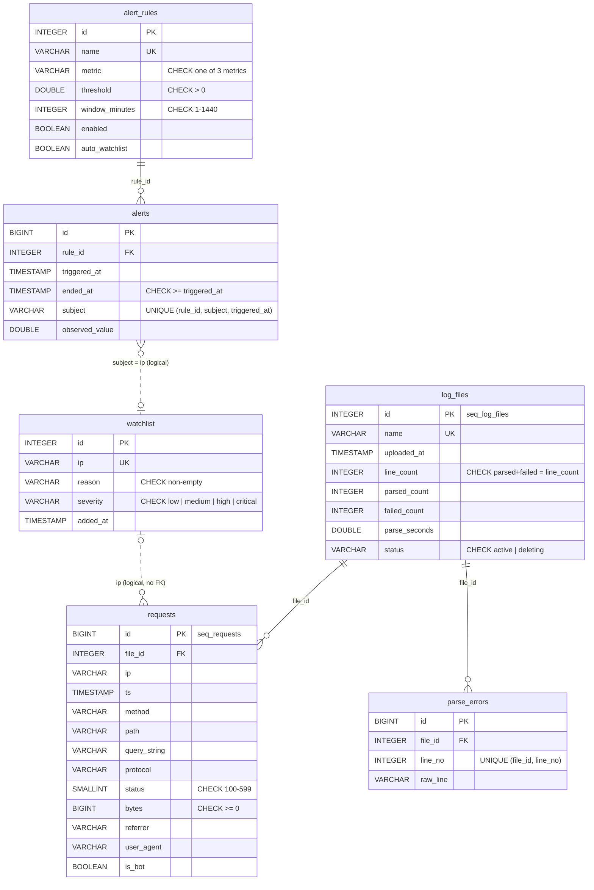

# LogLens: Web Server Log Analyzer

A DBMS mini-project: a Streamlit web app on top of an embedded **DuckDB** database.
It ingests Apache/Nginx access logs, parses them **in SQL**, and offers dashboards,
a filterable explorer, security analytics (brute force, scanners, error spikes,
bot floods), CRUD for a watchlist and alert rules, and a read-only SQL console.
Every report has a **Show SQL** expander with the exact query and its bound parameters.

## Setup and run

Requires Python 3.11+.

```bash
python -m venv .venv
```

```bash
.venv\Scripts\activate          # Windows  (macOS/Linux: source .venv/bin/activate)
```

```bash
pip install -r requirements.txt
```

Generate the sample logs (about 490k lines over 7 days plus an 18k-line second file):

```bash
python scripts/generate_logs.py
```

Start the app, then load the logs from **Upload & Files** ("Load sample logs", or upload the files):

```bash
streamlit run app.py
```

Or load from the command line instead (stop the app first, since DuckDB allows one writer process):

```bash
python scripts/ingest.py --reset --alerts
```

`generate_logs.py` options: `--lines`, `--days`, `--start`, `--small-lines`, `--seed`, `--out-dir`.

## Project structure

| Path | What it is |
|---|---|
| `app.py` | Entry point: page navigation and sidebar status |
| `pages/` | One file per page: `upload`, `dashboard`, `explorer`, `security`, `watchlist`, `alert_rules`, `sql_console` |
| `db.py` | Cached connection, schema bootstrap, ingestion, CRUD, alert evaluation, console guard |
| `ui.py` | Show-SQL expander, date filter, chart styling and palette |
| `schema.sql` | All DDL: sequences, tables, constraints, macros, views, seed rules |
| `queries.sql` | Every analytical and ingestion query, named with `-- name:` markers and commented |
| `scripts/generate_logs.py` | Synthetic log generator with injected incidents |
| `scripts/ingest.py` | Command-line ingestion and health check |
| `sample_logs/` | Generated logs (`access.log`, `access_small.log`) |

`db.py` loads `queries.sql` at startup and runs those blocks by name, so the SQL in
that file is exactly what executes, and the Show SQL expanders display it unchanged.

## ER diagram



## SQL and DBMS concepts used, and where

| Concept | Where |
|---|---|
| **Sequences** for surrogate keys | `schema.sql`: `seq_*`, used as `DEFAULT nextval(...)` |
| **PRIMARY KEY, FOREIGN KEY, NOT NULL, UNIQUE** | every table in `schema.sql`; composite UNIQUE on `parse_errors (file_id, line_no)` and `alerts (rule_id, subject, triggered_at)` |
| **CHECK** constraints, column- and table-level | `status BETWEEN 100 AND 599`, `severity IN (...)`, `metric IN (...)`, and the cross-column `parsed_count + failed_count = line_count` |
| **Transactions** (BEGIN / COMMIT / ROLLBACK) | `db.ingest_file` (one per file), `db.delete_log_file`, `db.delete_rule`, `db.run_alert_check`; the SQL console always rolls back |
| **Explicit cascading delete** | `db.delete_log_file`, `db.delete_rule` (children first; see the DuckDB notes below) |
| **Trigger-like logic** in the application layer | `db.normalize_ip` (BEFORE INSERT/UPDATE), `db._auto_watchlist` (AFTER INSERT on alerts), the cascades |
| **Views** | `hourly_traffic`, `endpoint_stats`, `status_summary`, `suspicious_ips` |
| **Scalar macros** (user-defined functions) | `status_class`, `is_scanner_path`, `is_bot_ua`, `normalize_path`, `parse_log_line` |
| **Table macros** (parameterized views) | `requests_between(start, end)` behind every dashboard chart; `filtered_requests(...)` behind the Explorer |
| **INSERT … SELECT** parsing pipeline | `queries.sql`: `stage_raw_lines` → `ingest_requests` / `ingest_parse_errors` (`read_csv`, `regexp_extract` with named groups returning a STRUCT, `strptime` / `try_strptime`) |
| **Parameterized queries** | everywhere (`$name` placeholders); Explorer filters are optional parameters, so the SQL never changes shape |
| **Joins**: INNER, LEFT, USING | `alerts_list` (INNER + LEFT), `top_ips` and `files_list` (LEFT), `suspicious_ips` (JOIN … USING, LEFT JOIN watchlist), `watchlist_with_activity` |
| **CTEs** (WITH) | `suspicious_ips`, `ip_timeline`, `watchlist_with_activity`, all three alert queries |
| **Aggregation** with FILTER, HAVING, GROUP BY ALL, ROLLUP | `hourly_traffic` (FILTER), `failed_logins` (HAVING), `status_summary_all` (ROLLUP), GROUP BY ALL throughout |
| **Window functions** | `status_summary` / `status_breakdown` (share of total via `sum(count(*)) OVER ()`), `traffic_over_time` (24 h moving average with a time-based RANGE frame), `suspicious_ips` (`rank()`), alert queries (sliding `RANGE` windows, `lag()`, running `sum()`) |
| **QUALIFY** | `busiest_hour_per_day` (top hour per day), console example "each IP's busiest minute" |
| **Gaps and islands** | alert queries: `lag()` + running `sum()` group consecutive breaching minutes into one episode |
| **Gap filling** with a generated series | `ip_timeline`: `range()` of minutes LEFT JOINed to the counts |
| **Percentiles** | `quantile_cont(bytes, 0.5 / 0.95)` in `kpis`, `top_endpoints`, `endpoint_stats` |
| **Subqueries** (scalar, IN, derived tables) | `watchlist_with_activity` (`IN (SELECT ...)`), seed insert (`NOT EXISTS`), ingestion (derived table) |
| **Upsert / conflict handling, RETURNING** | `run_alert_check`: `INSERT … ON CONFLICT DO NOTHING RETURNING`; auto-watchlist `ON CONFLICT (ip) DO NOTHING` |
| **LIMIT / OFFSET pagination** | `explorer_page` |
| **Export** to CSV and Parquet | Explorer (Arrow result → `pyarrow` writers) |
| **System catalog** | SQL Console → Schema browser (`duckdb_tables()`, `duckdb_views()`, `duckdb_constraints()`, `duckdb_functions()`) |
| **Read-only enforcement** | `db.check_read_only`: keyword whitelist, `extract_statements()` type check, blocklist for side-effecting functions and file reads, rollback |

## Injected incidents, and how they are detected

| Incident (sample data) | Found by |
|---|---|
| Brute force: `203.0.113.45` sends ~50 `POST /login` → 401 per minute for 2.5 h | `suspicious_ips` (score ≈ 55), *4xx flood per IP* alert, Security → Failed logins |
| Vulnerability scanner: `198.51.100.23` hits 50 paths like `/wp-admin`, `/.env`, `/phpmyadmin` → 404 | `suspicious_ips` (score 80), *4xx flood per IP* alert, Security → Scanner path hits |
| 500 spike: `/api/checkout` fails for 20 min | *5xx spike per endpoint* alert, Error-prone endpoints, the dashboard errors chart |
| Bot surge: `192.0.2.99` "AggressiveCrawler" at ~150 req/min for 1 h | `suspicious_ips` (score ≈ 52), *Request flood per IP* alert, Bot vs human chart |
| Second, smaller scan in `access_small.log` from `198.51.100.77` | appears once the second file is loaded |

The attacker IPs are from the RFC 5737 documentation ranges. A small number of malformed
lines (truncated writes, `"-"` request lines, TLS bytes on port 80, an impossible date)
land in `parse_errors`.

## Demo walkthrough (viva)

1. **Upload & Files**: load the sample logs. Show the parse time and rows/s, the parse
   errors, and the ingestion SQL. Delete `access_small.log` and load it again.
2. **Dashboard**: KPIs, traffic with the 24 h moving average, status classes, top
   endpoints and IPs, bots vs humans, the weekday × hour heatmap, and QUALIFY in
   *Busiest hour per day*. Narrow the date range to see every chart follow.
3. **Explorer**: filter `status = 401`, `method = POST`, and IP prefix `203.0.`; page
   through the results, then export to CSV or Parquet.
4. **Security**: the ranked `suspicious_ips` view. Pick `203.0.113.45` for its per-minute
   timeline, then add it to the watchlist in one click.
5. **Alert Rules**: press **Run alert check**. Five alerts appear and the 4xx rule
   auto-watchlists three IPs. Run it again to get zero new alerts (the UNIQUE constraint).
   Edit a threshold, re-run, and open the evaluation SQL.
6. **Watchlist**: add a row, edit it, delete it. Try an invalid IP or a duplicate to show validation.
7. **SQL Console**: run the examples, try `DELETE FROM requests` to see it rejected, and
   look at the Schema browser for constraints and view definitions.

## Why DuckDB suits log analytics

- **Embedded**: a library inside the Python process with a single database file. No
  server to install or run, which suits a self-contained project.
- **Columnar storage**: analytics read a few columns (`ts`, `status`, `ip`) across millions
  of rows. DuckDB stores and compresses each column separately and skips row groups using
  min/max zone maps. Logs arrive in time order, so date-range filters prune well without
  any index.
- **Vectorized OLAP engine**: aggregations, window functions and regex run over batches of
  values on all cores. Parsing the 490k-line sample (regex + strptime in SQL) takes
  about 8 s on a laptop.
- **Rich SQL**: `GROUP BY ALL`, `QUALIFY`, `FILTER`, macros, `regexp_extract` into STRUCTs,
  `read_csv` and Parquet export are built in.
- **Trade-off**: DuckDB is built for analytics, not many concurrent writers. One process may
  write at a time, which is why the app opens one cached connection.

### DuckDB limitations this project works around

- **No ON DELETE CASCADE, triggers or stored procedures.** Cascades and trigger-like
  behaviour live in `db.py`, each with a comment explaining why.
- **Deleting a parent row in the same transaction as its children fails.** DuckDB checks
  the foreign key against index entries that still hold the transaction's own deleted
  children ("over-eager constraint checking"). So a delete runs in two steps. First, one
  transaction marks the file `status = 'deleting'` and deletes all of its children. Second,
  the parent row is deleted. If the app stops between the steps, the childless row stays
  hidden and is purged on the next start.
- **Single writer process.** Stop the app before running `scripts/ingest.py`.
- **The SQL console guard is a demo safeguard**, not a security boundary. A production
  system would give the console its own read-only database connection.
